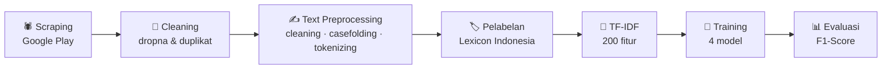

<div align="center">

# 💬 Analisis Sentimen Ulasan Aplikasi by.U di Google Play Store

**Klasifikasi teks bahasa Indonesia dengan NLP dan Machine Learning**


</div>

---

## 📌 Daftar Isi

- [Tentang Proyek](#-tentang-proyek)
- [Dataset](#-dataset)
- [Alur Pengerjaan](#-alur-pengerjaan)
- [Text Preprocessing](#-text-preprocessing)
- [Pelabelan Sentimen](#-pelabelan-sentimen)
- [Hasil Model](#-hasil-model)
- [Cara Menjalankan](#-cara-menjalankan)
- [Keterbatasan dan Pengembangan](#-keterbatasan-dan-pengembangan)

---

## 🎯 Tentang Proyek

Proyek ini menganalisis sentimen (positif/negatif) dari ulasan pengguna aplikasi **by.U** di Google Play Store. Ulasan diambil langsung dengan *web scraping*, dibersihkan dengan teknik NLP untuk bahasa Indonesia, diberi label dengan pendekatan *lexicon-based*, lalu dipakai untuk melatih dan membandingkan empat algoritma klasifikasi.

## 🗂️ Dataset

- **Sumber:** Ulasan Google Play Store aplikasi `com.byu.id`, diambil dengan [`google-play-scraper`](https://pypi.org/project/google-play-scraper/)
- **Bahasa / Negara:** Indonesia (`id`)
- **Data mentah:** 99.000 ulasan
- **Data setelah pembersihan:** 75.428 ulasan (data kosong dan duplikat dihapus)

| Sentimen | Jumlah Ulasan |
|:---------|:-------------:|
| 😠 Negatif | 42.696 |
| 😊 Positif | 32.732 |

## 🔄 Alur Pengerjaan



## ✍️ Text Preprocessing

| Tahap | Keterangan |
|:------|:-----------|
| **Cleaning** | Hapus mention, hashtag, link, angka, dan tanda baca |
| **Case folding** | Ubah semua huruf menjadi huruf kecil |
| **Normalisasi slang** | Ganti kata tidak baku ke bentuk baku (misalnya `bgt` → `banget`) |
| **Tokenizing** | Pecah teks menjadi token kata (NLTK) |
| **Stopword removal** | Hapus stopword bahasa Indonesia dan Inggris, ditambah kata informal (`gak`, `ga`, `sih`, dll.) |

## 🏷️ Pelabelan Sentimen

Label ditentukan dengan **lexicon-based sentiment analysis**. Setiap kata dicocokkan dengan kamus kata positif dan negatif yang masing-masing memiliki skor, lalu skor dijumlahkan:

- Skor total **≥ 0** → `positive`
- Skor total **< 0** → `negative`

Kamus lexicon bahasa Indonesia diambil dari [repositori ini](https://github.com/angelmetanosaa/dataset).

## 📈 Hasil Model

Fitur teks diekstraksi dengan **TF-IDF** (`max_features=200`, `min_df=17`, `max_df=0.8`). Data dibagi 80:20 untuk training dan testing (`random_state=42`).

| Model | F1 Train | F1 Test | Selisih |
|:------|:--------:|:-------:|:-------:|
| Naive Bayes | 0,7960 | 0,7903 | 0,006 |
| Random Forest | 0,9739 | 0,8445 | 0,129 |
| **Logistic Regression** | 0,8715 | **0,8686** | 0,003 |
| Decision Tree | 0,9739 | 0,7921 | 0,182 |


**Kesimpulan:** *Logistic Regression* memberi F1-Score test tertinggi (**86,86%**) dengan selisih train–test paling kecil, sehingga paling stabil. Random Forest dan Decision Tree mengalami *overfitting* karena skor training mencapai 97% tetapi turun jauh di data test.

## 🚀 Cara Menjalankan

```bash
git clone https://github.com/<username>/<nama-repo>.git
cd <nama-repo>
pip install -r requirements.txt
```

Buka notebook `Studi_Kasus_Implementasi_Klasifikasi_Teks_pada_NLP_Sentimen_Analisis_Review_APK_Play_Store.ipynb` di Google Colab atau Jupyter Notebook, lalu jalankan semua sel secara berurutan. Proses scraping 99.000 ulasan memerlukan waktu beberapa menit dan koneksi internet.

## 🔭 Keterbatasan dan Pengembangan

- [ ] Label dihasilkan oleh lexicon, bukan anotasi manusia, sehingga F1-Score mengukur seberapa baik model meniru lexicon. Validasi dengan sampel yang dilabeli manual akan membuat evaluasi lebih objektif.
- [ ] Menambahkan kelas **netral** (saat ini skor 0 digolongkan positif).
- [ ] Menerapkan *stemming* (Sastrawi) dan memperbanyak fitur TF-IDF (saat ini 200).
- [ ] Mencoba model berbasis *deep learning* seperti IndoBERT atau LSTM.
- [ ] Menambahkan *hyperparameter tuning* dan *cross-validation*.

## 👤 Author

**MiftahStudent** · Dicoding: Miftah Student

---

<div align="center">⭐ Jika proyek ini bermanfaat, jangan lupa beri bintang! ⭐</div>
